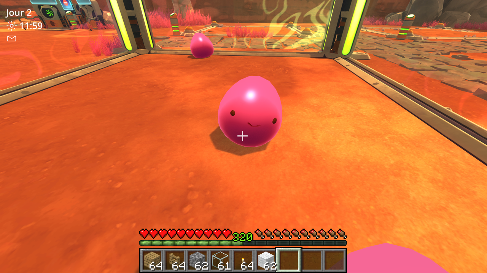
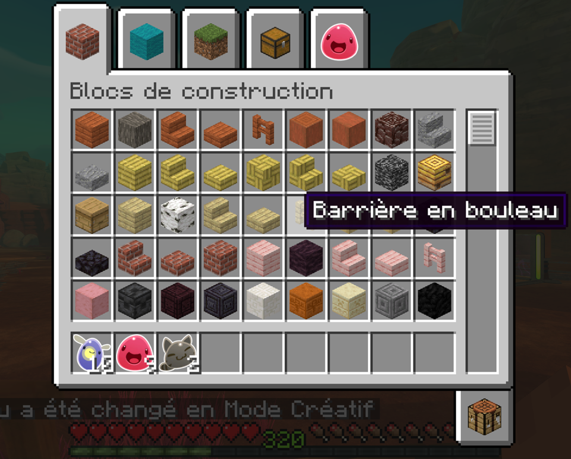
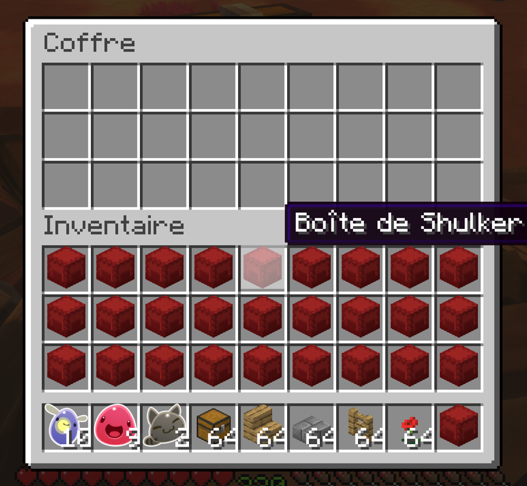

# SlimeCraft : Minecraft x Slime Rancher

[Français](#français) | [English](#english)

## Français

Un mod pour **Slime Rancher** (le premier) qui y reconstruit Minecraft : on joue Steve dans le Far, Far Range, avec la
physique, la main, le HUD, l'inventaire, les blocs et les sons de Minecraft, éclairés par le soleil et la nuit de
Slime Rancher. Les slimes se rangent dans l'inventaire au clic droit et se tiennent en main en 3D.

Un seul jeu tourne : pas de Minecraft lancé à côté. Les textures, sons et polices de Minecraft sont extraits **de ta
propre copie de Minecraft 1.20.1** au moment de l'installation ; ce dépôt ne contient aucun fichier de Mojang ni de
Monomi Park.

Par Amai.

### Ce qu'il y a dedans

- **Physique de Minecraft** : marche, sprint, accroupi qui ne tombe pas des bords, saut d'un bloc, dégâts de chute,
  nage. Le jetpack est retiré : on monte en empilant des blocs.
- **Main de Steve** en vue subjective avec les animations de Minecraft (balancement, coup, changement d'objet), vue
  à la 3e personne avec F5.
- **Slimes, plorts, fruits, légumes, poules** : clic droit pour les ranger dans l'inventaire, clic droit avec un slime
  en main pour le reposer, nourrir un slime en le visant avec de la nourriture, lancer un objet avec A/Q (les plorts
  lancés dans le marché se vendent).
- **565 blocs de Minecraft** : cubes, bûches, dalles, escaliers, barrières, tapis, fleurs, torches (qui éclairent),
  coffres, tonneaux et boîtes de Shulker (qui gardent leur contenu, slimes compris).
- **Survie et Créatif** (F3 + F4) : en Survie une palette gratuite de blocs simples ; en Créatif tous les blocs, un
  onglet avec tous les slimes, largos et objets de Slime Rancher, la casse instantanée et le vol (double espace).
- **Stockage de Slime** : un onglet de l'inventaire pour garder ses slimes au chaud.
- HUD : cœurs = vie, cuisses = énergie, barre verte = avancée de la journée, chiffre vert = Newbucks.

 

### Installation

Il faut **Slime Rancher** (Steam, version PC) et **Minecraft Java 1.20.1** installé avec le launcher officiel.

1. Télécharge le zip de la dernière version dans [Releases](../../releases).
2. Ouvre le dossier de Slime Rancher (Steam : clic droit sur le jeu, Gérer, Parcourir les fichiers locaux) et
   décompresse le zip dedans, à côté de `SlimeRancher.exe`. Le zip contient BepInEx 5, le chargeur de mods.
3. Si tu n'as jamais lancé Minecraft **1.20.1** : dans le launcher Minecraft, crée une installation 1.20.1, lance-la
   une fois jusqu'au menu, puis ferme-la.
4. Lance `BepInEx\plugins\SlimeCraft\SlimeCraft-Assets.exe` : il copie les textures et les sons depuis ton Minecraft.
5. Lance Slime Rancher et charge une partie.

Conseil : fais une copie de tes sauvegardes avant (`%USERPROFILE%\AppData\LocalLow\Monomi Park\Slime Rancher`).

### Commandes

| Touche | Action |
|---|---|
| ZQSD (AZERTY) / WASD (QWERTY), espace | se déplacer, sauter |
| Ctrl ou double avant | sprinter |
| Maj | s'accroupir |
| Clic droit sur un slime, plort, fruit, légume, poule | le ranger dans l'inventaire |
| Clic droit avec un slime en main | le reposer là où tu vises |
| Clic droit sur un slime avec de la nourriture | le nourrir (Maj + clic droit : l'attraper quand même) |
| Clic droit dans le vide avec un fruit ou un légume | le manger (rend de l'énergie) |
| Clic droit sur un coffre, tonneau, boîte de Shulker | l'ouvrir |
| Clic droit sur un bouton, une porte, un écran de Slime Rancher | l'utiliser (remplace E) |
| Clic gauche | casser un bloc, repousser un slime (3 coups font éclater un Tarr) |
| Clic molette | prendre le bloc visé |
| A (AZERTY) / Q (QWERTY) | lancer l'objet tenu (Ctrl : toute la pile) |
| E | inventaire |
| F3 + F4 | passer en Survie / Créatif |
| F5 | vue à la 3e personne / de face |
| 1 à 9, molette | hotbar |

### Compiler le mod soi-même

- .NET SDK 8, Python 3 avec Pillow, Slime Rancher et BepInEx 5.4 installés.
- `python tools/extract_assets.py` remplit `plugin/assets` depuis ton Minecraft 1.20.1.
- `dotnet build -c Release` dans `plugin/` (le dossier du jeu se règle avec `-p:GameDir=...`) copie la DLL et les
  assets dans `BepInEx/plugins/SlimeCraft`.
- L'outil d'extraction en .exe : `python -m PyInstaller --onefile --name SlimeCraft-Assets --paths tools tools/extract_assets.py`.

### Mentions

Minecraft appartient à Mojang Studios, Slime Rancher à Monomi Park. Projet de fan non officiel, sans lien avec eux.
BepInEx est distribué sous licence LGPL 2.1 ([github.com/BepInEx/BepInEx](https://github.com/BepInEx/BepInEx)).
Le code de SlimeCraft est sous licence MIT.

## English

A mod for **Slime Rancher** (the first one) that rebuilds Minecraft inside it: you play Steve in the Far, Far Range,
with Minecraft's physics, hand, HUD, inventory, blocks and sounds, lit by Slime Rancher's sun and nights. Right click
a slime to put it in your inventory and hold it in your hand in 3D.

Only one game runs: no Minecraft running alongside. Minecraft's textures, sounds and fonts are extracted **from your
own copy of Minecraft 1.20.1** during installation; this repository contains no files from Mojang or Monomi Park.

By Amai.

### Features

- **Minecraft physics**: walking, sprinting, sneaking that stops at edges, one-block jumps, fall damage, swimming.
  The jetpack is gone: you climb by stacking blocks.
- **Steve's hand** in first person with Minecraft's animations (bobbing, swing, item switching), third person with F5.
- **Slimes, plorts, fruits, veggies, chickens**: right click to put them in your inventory, right click with a slime
  in hand to put it down, feed a slime by aiming at it with food, throw an item with A/Q (plorts thrown into the
  market are sold).
- **565 Minecraft blocks**: cubes, logs, slabs, stairs, fences, carpets, flowers, torches (which give light), chests,
  barrels and shulker boxes (which keep their contents, slimes included).
- **Survival and Creative** (F3 + F4): Survival has a free palette of basic blocks; Creative has every block, a tab
  with every slime, largo and item from Slime Rancher, instant breaking and flying (double tap space).
- **Slime Storage**: an inventory tab to keep your slimes safe and warm.
- HUD: hearts = health, drumsticks = energy, green bar = time of day, green number = Newbucks.
- The mod follows the language set in Slime Rancher's options (Minecraft's own translations for block names).

### Installation

You need **Slime Rancher** (Steam, PC version) and **Minecraft Java 1.20.1** installed with the official launcher.

1. Download the zip of the latest version from [Releases](../../releases).
2. Open the Slime Rancher folder (Steam: right click the game, Manage, Browse local files) and unzip the zip there,
   next to `SlimeRancher.exe`. The zip includes BepInEx 5, the mod loader.
3. If you have never played Minecraft **1.20.1**: in the Minecraft launcher, create a 1.20.1 installation, play it
   once up to the title screen, then close it.
4. Run `BepInEx\plugins\SlimeCraft\SlimeCraft-Assets.exe`: it copies the textures and sounds from your Minecraft.
5. Start Slime Rancher and load a save.

Tip: back up your saves first (`%USERPROFILE%\AppData\LocalLow\Monomi Park\Slime Rancher`).

### Controls

| Key | Action |
|---|---|
| WASD (QWERTY) / ZQSD (AZERTY), space | move, jump |
| Ctrl or double tap forward | sprint |
| Shift | sneak |
| Right click a slime, plort, fruit, veggie, chicken | put it in your inventory |
| Right click with a slime in hand | put it down where you aim |
| Right click a slime while holding food | feed it (Shift + right click: pick it up anyway) |
| Right click the air with a fruit or veggie | eat it (restores energy) |
| Right click a chest, barrel, shulker box | open it |
| Right click a Slime Rancher button, door, screen | use it (replaces E) |
| Left click | break a block, push a slime back (3 hits pop a Tarr) |
| Middle click | pick the block you aim at |
| Q (QWERTY) / A (AZERTY) | throw the held item (Ctrl: the whole stack) |
| E | inventory |
| F3 + F4 | switch between Survival and Creative |
| F5 | third person / front view |
| 1 to 9, mouse wheel | hotbar |

### Building the mod yourself

- .NET SDK 8, Python 3 with Pillow, Slime Rancher and BepInEx 5.4 installed.
- `python tools/extract_assets.py` fills `plugin/assets` from your Minecraft 1.20.1.
- `dotnet build -c Release` in `plugin/` (set the game folder with `-p:GameDir=...`) copies the DLL and the assets
  into `BepInEx/plugins/SlimeCraft`.
- The extraction tool as an .exe: `python -m PyInstaller --onefile --name SlimeCraft-Assets --paths tools tools/extract_assets.py`.

### Credits

Minecraft belongs to Mojang Studios, Slime Rancher to Monomi Park. Unofficial fan project, not affiliated with them.
BepInEx is distributed under the LGPL 2.1 license ([github.com/BepInEx/BepInEx](https://github.com/BepInEx/BepInEx)).
SlimeCraft's code is under the MIT license.
